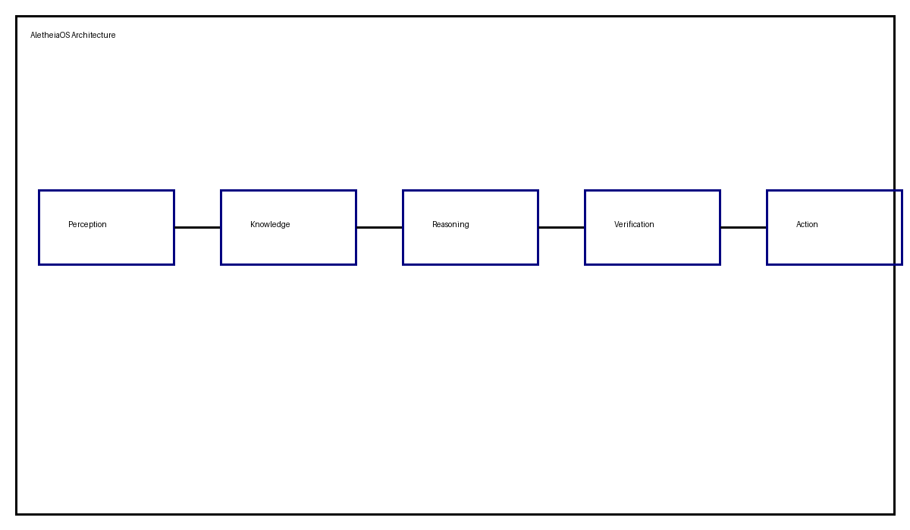
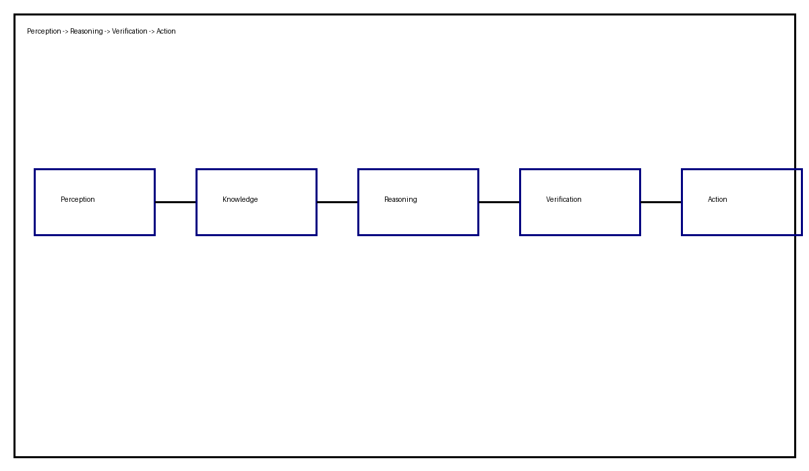

# AletheiaOS

**A Neuro-Symbolic Cognitive Architecture for Deterministic Reasoning**

AletheiaOS is an experimental AI architecture that combines neural perception with symbolic reasoning, ontology-driven knowledge representation, constraint solving, planning, and formal verification.

## Vision

Move beyond probability-driven token generation toward:

- Concept grounding
- World modeling
- Knowledge graphs
- Causal reasoning
- Constraint solving
- Formal verification

## Architecture

## Cognitive Loop

## Core Components

1. Perception Layer
2. Semantic Parser
3. RDF Knowledge Store (RDF4J)
4. OWL Ontology Layer
5. Symbolic Reasoning Engine
6. Constraint Solver (Z3)
7. Planner & Goal Manager
8. Verification Engine
9. Action Generator

## Roadmap

- v0.1 Core ontology and memory model
- v0.2 Rule engine
- v0.3 Planning framework
- v0.4 Neuro-symbolic integration
- v1.0 Autonomous cognitive system

## License

MIT
