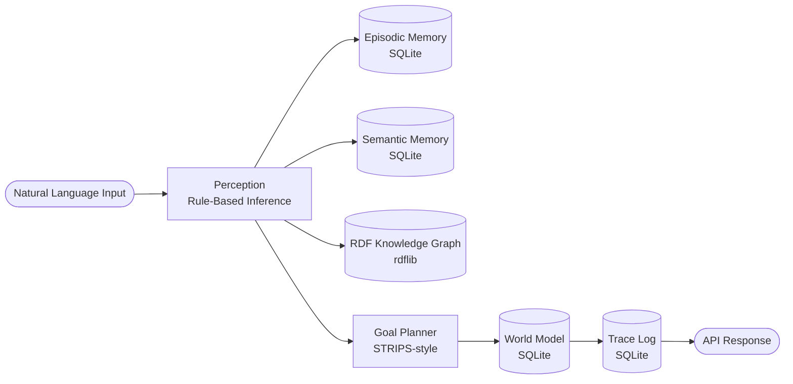
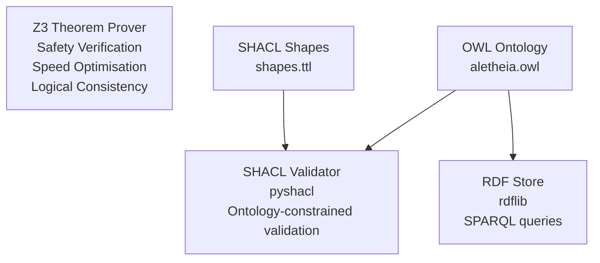

# AletheiaOS — System Architecture

## Overview

AletheiaOS is a **neuro-symbolic cognitive architecture** that combines rule-based symbolic reasoning with formal logic tools (Z3, SHACL, RDF/OWL) inside a production-grade FastAPI service.

---

## Cognitive Pipeline



### Pipeline Stages

| Stage | Component | What it does |
|-------|-----------|--------------|
| **1. Perception** | `CognitiveEngine` | Applies 25+ inference rules to extract symbolic conclusions from text |
| **2. Episodic Memory** | `EpisodicMemoryService` | Stores raw event + inference in time-ordered DB table |
| **3. Semantic Memory** | `SemanticMemoryService` | Stores RDF-style (subject, predicate, object) facts |
| **4. RDF Assertion** | `RDFStore` | Adds observation triple to in-process knowledge graph |
| **5. Planning** | `GoalPlanner` | Maps primary inference → prioritised action sequence |
| **6. World Model** | `WorldModelService` | Merges environment key-values into persistent state |
| **7. Trace Logging** | `TraceService` | Writes full processing record with timing |

---

## Reasoning Subsystem



### Z3 Capabilities

| Endpoint | Z3 Operation | What it proves |
|----------|-------------|----------------|
| `/z3/safety-check` | `Solver` — refutation search | Safety claim: stopping distance ≤ visibility |
| `/z3/optimize-speed` | `Optimize` — linear maximisation | Max speed satisfying both safety and legal constraints |
| `/z3/consistency-check` | `Solver` — satisfiability | Symbolic facts are mutually consistent |

---

## Data Model

```
episodic_events        — temporal event log (id, content, inference, confidence, session_id, timestamp)
semantic_facts         — RDF-like fact store (id, subject, predicate, object, confidence, active)
trace_logs             — full processing traces (id, input_text, plan_actions, processing_time_ms)
world_state            — environment key-value store (key, value_json, last_updated)
```

---

## API Structure

```
GET  /health                              Liveness probe
GET  /api/v1/status                       Detailed system status

POST /api/v1/cognitive/process            Full cognitive pipeline
GET  /api/v1/cognitive/traces             Processing trace log

GET  /api/v1/memory/episodic              List episodic events
DELETE /api/v1/memory/episodic            Clear episodic events
GET  /api/v1/memory/semantic              List semantic facts
POST /api/v1/memory/semantic              Add a fact manually
DELETE /api/v1/memory/semantic/{id}       Deactivate a fact
DELETE /api/v1/memory/semantic            Clear all facts
GET  /api/v1/memory/stats                 Memory counts

POST /api/v1/reasoning/z3/safety-check   Z3 road safety
POST /api/v1/reasoning/z3/optimize-speed Z3 optimal speed
POST /api/v1/reasoning/z3/consistency-check Z3 fact consistency
POST /api/v1/reasoning/shacl/validate    SHACL graph validation
GET  /api/v1/reasoning/rdf/triples       All RDF triples
POST /api/v1/reasoning/rdf/triple        Add triple
POST /api/v1/reasoning/rdf/query         SPARQL SELECT
GET  /api/v1/reasoning/rdf/stats         Triple count

POST /api/v1/planning/plan               Generate action plan
GET  /api/v1/planning/goals              Available goals

GET  /api/v1/world/state                 World model state
POST /api/v1/world/update                Merge state updates
DELETE /api/v1/world/reset               Reset world model
```

---

## Technology Stack

| Layer | Technology |
|-------|-----------|
| API framework | FastAPI + Pydantic v2 |
| ASGI server | Uvicorn |
| Database ORM | SQLAlchemy 2.0 |
| Database | SQLite (dev) / PostgreSQL (prod) |
| Knowledge graph | rdflib 7 |
| Ontology | OWL / owlready2 |
| Shape validation | SHACL / pyshacl |
| Constraint solving | Z3 theorem prover |
| Testing | pytest + httpx |
| Containerisation | Docker + Docker Compose |
